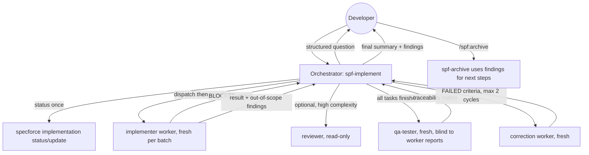

# Technical Design: Independent QA Tester, Free Batch Narration and Named Execution Roles

## 1. Architecture Blueprint
The change is confined to embedded kit blueprints (YAML/Markdown text), their Go manifest tests, and the module living spec. No Go production code, CLI command, `kit.yaml` mapping, or persistence is modified (`[BR-KIT-01]`: the kit contains only skills).

Role correspondence (embedded verbatim as a compact table in `spf-implement`):

| Kind of work | Role | Model tier / effort |
|---|---|---|
| Scaffolding, boilerplate, simple tweaks | implementer | fast / low |
| Business logic, CRUD, component features, local tests | implementer | balanced / medium |
| Core architecture, concurrency, security, complex algorithms | implementer, then optional reviewer | reasoning / high |
| Final validation of all acceptance criteria | qa-tester | reasoning / high |
| No match | implementer | balanced / medium |

## 4. File & Component Inventory

**Backend:**
- `[src/internal/agent/kit/skills/spf-implement/SKILL.yaml]` -> Rewrite the sections below. Resulting file MUST NOT exceed 222 lines (current length) and MUST remain valid YAML with `name` and `content` keys.
  - Step 1: add **Resume Handling**. Tasks in `in-progress` are reported and re-batched as pending after inspecting the affected code; tasks in `failed` trigger an interactive question (retry, revise spec via `/spf:spec`, stop); if no pending tasks remain, skip to Step 4. Status is still requested exactly once.
  - Step 2: remove duplicated sizing text (keep a single "Subagent Sizing" block), keep "Fresh Subagent per Batch", "Within-Batch Feedback Loop", "Universal Harness Compatibility", "Strict Task Boundary Safety" (stated once, here only).
  - Step 2.B: replace persona-per-batch prose with a **Role Charters** table (implementer, qa-tester, reviewer) and the correspondence table above. Each charter lists Mission, Allowed, Forbidden, Inputs, Output. Keep "Adaptive Model & Effort Routing" heading.
  - Step 2.C: Mission Brief Envelope keeps sections 1 to 4; remove the "Recommended Model Tier/Effort" lines; add to section 2 a **BLOCKED Protocol**: workers never ask the user; they stop and return `BLOCKED: <question> | <options> | <recommendation>`; add an **Out-of-Scope Findings** return section (list only, never acted upon).
  - Step 2.C `MANDATORY LOG`: replace the fixed template with **Free-Form Batch Narration**: dispatch first, then 1 to 3 sentences naming concrete areas, approach and verification; short progress prefix `Batch {batch_index}/{total_batches} · {completed_tasks_count}/{total_tasks_count}`; user's most recent language; no fixed emoji header, no bracketed chains.
  - Step 3: keep terminal verification, status updates and 2-iteration within-batch loop; replace the `[BATCH ... COMPLETED]` line with a natural completion summary of what was delivered; handle `BLOCKED` reports by consulting the user (reusing the existing Human-in-the-Loop block) and replying to the SAME worker; fix duplicate step numbering.
  - Step 4: rename persona to `qa-tester` charter; QA input is `requirements.md`, `design.md`, `tasks.md` and the diff, never worker reports (for small specs, the `tasks.md` Acceptance Checks); the existing "4-Tier QA Verification Protocol" and its four tier names stay verbatim as the method; add the **Traceability Matrix** (criterion, scenario, evidence, verdict `PASSED | FAILED | NOT-VERIFIABLE`); qa-tester may add verification-only tests/scripts but never edits production behavior; orchestrator re-executes at least one key verification; **Correction Cycle**: on `FAILED`, dispatch a fresh correction worker with the failed criteria and evidence, then a fresh qa-tester, maximum 2 cycles, then escalate with evidence; changes of behavior or architecture halt and require `/spf:spec`.
  - Step 4.D Final Output Format: keep headers `4-Tier QA Verification Evidence` and `Developer Manual Walkthrough`; add `### Traceability Matrix`, `### Correction Cycles Used`, `### Out-of-Scope Findings`; replace `> Run \`/archive\`` with `> Run \`/spf:archive\` to close the lifecycle.`
  - Guardrails: remove items duplicated elsewhere (Human-in-the-Loop, Task Boundary Safety); keep Mid/Post-Implementation Spec Gate, Terminal Truth, Scope Containment, No Interactive Prompts, CLI Execution.
- `[src/internal/agent/kit/skills/spf-spec/SKILL.yaml]` -> Replace `> Run \`/implement\` to start implementing.` with `> Run \`/spf:implement\` to start implementing.`
- `[src/internal/agent/kit/skills/spf-archive/SKILL.yaml]` -> In item 4 "Suggest Next Steps & Follow-up Specs" (heading text unchanged), add: derive suggestions from out-of-scope findings and NOT-VERIFIABLE criteria present in the conversation, at most 3, each as a ready-to-use `/spf:discovery` or `/spf:spec` request citing its origin; when none exist, say so.
- `[src/internal/agent/kit/skills/spf-discovery/SKILL.yaml]` -> No change. Its content has no lifecycle command names (verified by search), so US-8 requires no edit there.
- `[src/internal/agent/kit/instructions/archive.md]` -> In "### 7. Verification & Handoff" keep the heading `### Suggested Next Steps & Follow-up Specs:`; change the two example bullets to `- [Next Step 1, from: <finding or unverifiable criterion>]: /spf:discovery or /spf:spec request` and the same for step 2; add a line `At most 3 steps; if no findings were reported, state that and base steps on the completed work.`
- `[.specforce/docs/modules/agent-kit.md]` -> Update behavioral rules and use cases: `[BR-KIT-05]` (final worker is an independent qa-tester), `[BR-KIT-09]` (replace the fixed `🚀 **Iniciando Lote X/Y**` + `[BATCH X/Y COMPLETED]` standard with free-form post-dispatch narration, progress prefix, user language), `[BR-KIT-12]` (4-tier protocol governed by a criterion traceability matrix; qa-tester read-only; 2 correction cycles), `[BR-KIT-14]` (add BLOCKED protocol). Add `[BR-KIT-15]` (named role charters inside skills) and `[BR-KIT-16]` (out-of-scope findings and resumption). Update `[US-KIT-07]` and `[US-KIT-11]`; add `[US-KIT-14]` (correction cycle) and `[US-KIT-15]` (BLOCKED escalation). Keep the 5-part structure and omit internal file paths.

**Tests:**
- `[src/internal/agent/kit_manifests_test.go] -> TestImplementBatchSubagentIsolationAndProgress` -> Keep `Fresh Subagent per Batch`, `Within-Batch Feedback Loop`, `completed_tasks_count`, `total_tasks_count`; remove `Iniciando Lote`, `concluídas`, `Delegando para perfil de`, `BATCH`, `COMPLETED`; add `Free-Form Batch Narration`; add a negative assertion that `Iniciando Lote` and `Delegando para perfil de` are absent.
- `[src/internal/agent/kit_manifests_test.go] -> TestActiveQAAndBlockerProtocols` -> Keep all current required tokens; add `Traceability Matrix`, `NOT-VERIFIABLE`, `Correction Cycle`, `BLOCKED`, `Out-of-Scope Findings`, `Developer Manual Walkthrough`.
- `[src/internal/agent/kit_manifests_test.go] -> TestEnhancedBlueprintsDirectives` -> Keep all tokens (including `Worker Reuse & Feedback Loop`, `SAME subagent`); the archive assertions keep `Suggest Next Steps & Follow-up Specs` and `Suggested Next Steps & Follow-up Specs`.
- `[src/internal/agent/kit_manifests_test.go] -> TestImplementGlobalBatchBudgetAndSizing` -> No change; the budget and sizing tokens must survive consolidation.
- `[src/internal/agent/kit_manifests_test.go] -> TestImplementBlueprintGuardrails` -> No change; all worker guardrail tokens must survive consolidation.
- `[src/internal/agent/kit_manifests_test.go] -> TestImplementRoleChartersAndResume` (new) -> Assert the implement skill contains `Role Charters`, `implementer`, `qa-tester`, `reviewer`, `Resume Handling`, and that its line count is at most 222.
- `[src/internal/agent/kit_manifests_test.go] -> TestLifecycleCommandNaming` (new) -> For `spf-implement`, `spf-spec`, `spf-archive`, `spf-discovery` and `instructions/archive.md`, assert the strings `/spf:implement`, `/spf:archive` and `/spf:spec` appear where hand-offs exist, and that the unprefixed forms `` `/archive` `` and `` `/implement` `` are absent.

## 5. Verification Commands
- Unit and manifest tests: `go test ./src/internal/agent/...`
- Full regression: `go test ./...`
- YAML validity: covered by `TestPureSkillsBlueprintStructure` (parses every `SKILL.yaml`).
- Workspace skill sync for local use (ignored by git, not committed): `specforce init <agent>` re-generates `.agents/skills/spf-implement/SKILL.md` from the embedded kit; use `--dev` to read the local kit.
