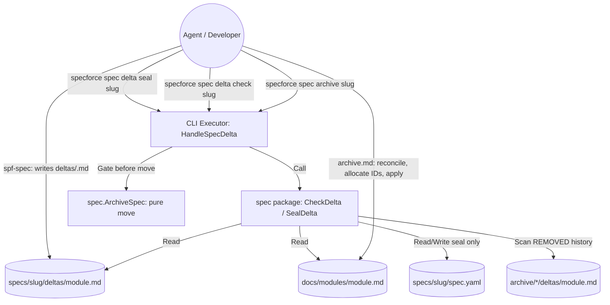

# Technical Design: Delta Specs and Structured Module Living Specs

## 1. Architecture Blueprint

The agent writes and applies deltas and module content (instruction-driven); Go code only parses, fingerprints and verifies (read-only, plus `seal` which writes `spec.yaml`).



**Decisions already confirmed (do not re-open):** module prefix in frontmatter; delta in `deltas/<module>.md`, one file per module, outside the artifact registry; ADDED uses provisional keys and final IDs are allocated at archive and recorded in `id_map`; agent applies, CLI verifies; operations are ADDED/MODIFIED/REMOVED with full-block MODIFIED; module sections 1/4/5 are not delta items; stale-base fingerprints recorded at seal; delta required for `medium`+ (or `impact: none`), `small` exempt; `spec delta check` read-only plus a gate in the archive handler with no bypass flag; lazy legacy-module migration; Constitution documents untouched.

**Consequences resolved in this design:**
- Fingerprints cannot be computed by the agent reliably, so a write command `specforce spec delta seal <slug>` computes and stores them (it is the only delta command that writes, and it writes only `spec.yaml`).
- Because the agent applies the delta before archive, a stale base is detected by a three-way state per item (matches base fingerprint = pending, matches delta text = applied, anything else = conflict), not by comparing against the base alone.
- The gate runs in the CLI archive handler, not inside the pure move function, so existing archive-move tests and the move itself stay unchanged.
- A MODIFIED use case must keep at least as many scenarios as the current module block (count comparison), which prevents silent scenario loss without forcing title equality.

## 2. Persistence & Data Modeling

**Specification metadata (`spec.yaml`)** gains an optional typed `delta` field (`omitempty`, so existing files are unchanged):

```yaml
delta:
  impact: modules          # "modules" | "none"; absent means "not declared"
  modules:
    - module: spec-management      # lowercase hyphenated name; module doc is docs/modules/<module>.md
      base_hashes:                 # written only by `spec delta seal`
        BR-SPEC-03: "<64-hex fingerprint>"
        BR-SPEC-07: "<64-hex fingerprint>"
      id_map:                      # written by the agent at archive
        "NEW:delta-check": BR-SPEC-05
```

**Module document** starts with a frontmatter block declaring the unique prefix, e.g. `prefix: SPEC` (uppercase letters only), followed by the existing `# Module:` title. Block conventions the parser accepts:
- **Rule block (kind `BR`):** a top-level bullet whose first token is `[BR-<PREFIX>-<NN>]`, optionally wrapped in backticks or bold (`` - `[BR-SPEC-01]` `` and `- **[BR-SPEC-01]**` are both valid). The block runs through every following line that is indented or blank-followed-by-indented, ending at the next top-level bullet or heading.
- **Use-case block (kind `US`):** a `###` heading `### [US-<PREFIX>-<NN>] Title`, running to the next heading of level 1-3.
- Lines inside fenced code blocks are ignored.

**Delta document (`.specforce/specs/<slug>/deltas/<module>.md`):**

```markdown
# Delta: spec-management
## ADDED
- [NEW:delta-check] Full rule text (a bullet makes it a BR block)
### [NEW:us-delta-gate] Title (a heading makes it a US block)
- **Scenario:** ...
## MODIFIED
- [BR-SPEC-03] COMPLETE replacement text of the block
## REMOVED
- [BR-SPEC-07]
```

**Fingerprint:** SHA-256 hex of the normalized block text (LF line endings, trailing whitespace trimmed per line, leading/trailing blank lines removed). For ADDED comparison, the provisional token `NEW:<key>` in the delta block is replaced by the final identifier before normalization.

**Report model (also the `--json` output of `spec delta check`):**

```json
{
  "slug": "…",
  "status": "none|exempt|missing|pending|applied|invalid",
  "impact": "modules|none|",
  "modules": [
    {
      "module": "spec-management",
      "prefix": "SPEC",
      "next_free": {"BR": "BR-SPEC-05", "US": "US-SPEC-05"},
      "items": [
        {"op": "ADDED|MODIFIED|REMOVED", "id": "BR-SPEC-03", "key": "NEW:x",
         "state": "pending|applied|conflict|unsealed|invalid", "message": "…"}
      ]
    }
  ],
  "problems": ["…"]
}
```

`modules` and `problems` are always initialized as empty arrays, never `null`.

**Status derivation (in order):**
1. Any problem recorded → `invalid`.
2. No delta files and no metadata modules: `impact: none` → `none`; size `small` → `exempt`; otherwise → `missing`.
3. Any item in `pending`/`unsealed` → `pending`; else every item `applied` → `applied`.

**Per-item state** (current = normalized block in module, delta = normalized block in delta file, base = recorded fingerprint):
- ADDED: if `id_map[key]` exists and the module block with that identifier equals the delta block (key replaced) → `applied`; exists but differs → `conflict`; `id_map` missing or the block absent → `pending`. An ADDED item using a final identifier instead of `NEW:` → `invalid`. A key already mapped to an identifier not present in the module → `pending`.
- MODIFIED: module block absent → `invalid` (not found). No recorded base → `unsealed`. delta equals base → `invalid` (no effect). current equals delta → `applied`; current equals base → `pending`; otherwise → `conflict` (message instructs redoing the delta against the current module and re-sealing). When `pending` and the delta block has fewer scenario lines (`- **Scenario:**`) than current → `invalid` (scenario loss).
- REMOVED: no recorded base and block present → `unsealed`; block present with fingerprint equal base → `pending`; block present with another fingerprint → `conflict`; block absent and a base exists → `applied`; block absent and no base → `invalid` (not found).

**Module-level problems:** target module file missing; module name not matching `^[a-z0-9]+(-[a-z0-9]+)*$`; target module lacks `prefix`; identifier prefix mismatching the module's prefix; duplicate identifier within a module; duplicate prefix across modules (checked over all modules that declare one); same identifier under two operations; `impact: none` together with delta files; `impact: modules` without delta files; metadata module entry without delta file; delta file without metadata entry for a MODIFIED/REMOVED item (`unsealed`).

**Next-free identifier:** per kind, `max(number)+1` over (module blocks of that kind ∪ identifiers listed under REMOVED in every `deltas/<module>.md` found under `.specforce/specs/*/` and `.specforce/archive/*/`), zero-padded to two digits minimum, so removed identifiers are never reused.

## 3. API & Interfaces (The Contract)

**New CLI commands** (cobra group `specforce spec delta`):

- `specforce spec delta check <slug> [--json]`
  - Read-only. Prints human-readable lines via `core.UI` (or the JSON report on `--json`).
  - Exit code 0 for statuses `none|exempt|missing|pending|applied`; non-zero (error wrapping `core.ErrDeltaInvalid`) for `invalid`. A JSON report is printed before returning the error in `--json` mode.
- `specforce spec delta seal <slug> [--json]`
  - For each module delta file: validates structure, computes the fingerprint of the current module block of every MODIFIED/REMOVED item and writes `delta.impact: modules` plus `delta.modules[].base_hashes` to `spec.yaml` (preserving existing `id_map`). Refuses (error wrapping `core.ErrDeltaInvalid`, nothing written) when any item is invalid or its current block already equals the delta text. Re-running seal is the supported way to redo a delta after a base conflict.
  - Prints the resulting report.

**Changed CLI command:** `specforce spec archive <slug> [--force]` runs the delta check after the existing pending-tasks check. Allowed statuses: `none`, `exempt`, `applied`. Otherwise it prints the problems and the exact next step (for example `specforce spec delta check <slug>`) via `ui.Error` and returns an error wrapping `core.ErrDeltaNotApplied` (statuses `missing|pending`) or `core.ErrDeltaInvalid` (`invalid`). `--force` only affects the pending-tasks check. The filesystem is untouched on refusal.

**New domain errors** in `core/errors.go`: `ErrDeltaInvalid = errors.New("delta is invalid")`, `ErrDeltaNotApplied = errors.New("delta is not applied")`. Callers use `errors.Is`.

**Security:** module names are validated against the regex above before any path is built; the resolved path must stay inside `.specforce/docs/modules/` (verified with `filepath.Rel`); symlinked module or delta files are rejected with `os.Lstat`. `spec.yaml` keeps mode `0600` through `SaveMetadata`.

**Blueprint contract changes (instruction text only):**
- `spf-spec`: for `medium`+ specs, after requirements/design and before tasks, write one delta per affected module (or set `delta.impact: none`), run `specforce spec delta seal <slug>`, ensure tasks cover every delta item, list the delta in the hand-off summary.
- `archive.md` (reconciliation step): update the delta to the as-built result, run `specforce spec delta check <slug> --json` for `next_free`, allocate final identifiers in order of appearance and write `id_map`, apply the delta so module blocks equal delta blocks, rewrite sections 1/4/5 as-built where affected, lazily migrate a prefix-less target module (propose a prefix, confirm with the user through the interactive question tool, preserve every rule and scenario verbatim), run `specforce spec delta check <slug>` and require `applied` before `specforce spec archive <slug>`; the closing summary lists each updated module as a link with counts.
- `spf-implement` (qa-tester charter and traceability matrix): add one row per delta item (operation plus identifier or key) with the existing verdict vocabulary; no delta rows when there is no delta or `impact: none`; a REMOVED row fails when the block is still present.
- Module template (`artifacts/constitution/module.yaml`): frontmatter `prefix`, rule identifiers as `[BR-<PREFIX>-NN]`, use cases as `### [US-<PREFIX>-NN]`.

## 4. File & Component Inventory

**Backend (Go):**
- `[src/internal/core/errors.go]` -> add `ErrDeltaInvalid`, `ErrDeltaNotApplied`.
- `[src/internal/spec/metadata.go] -> Metadata` extended with `Delta *DeltaMetadata` (`yaml:"delta,omitempty"`, `json:"delta,omitempty"`), plus `DeltaMetadata` and `DeltaModuleMetadata` structs.
- `[src/internal/spec/module.go]` (new) -> `Module`, `Block`, `ParseModule`, `LoadModule`, `ValidateModuleName`, `NormalizeBlock`, `Fingerprint`, `NextFreeID`, duplicate-prefix scan.
- `[src/internal/spec/delta.go]` (new) -> `DeltaItem`, `ParseDelta`, `DeltaReport`, `DeltaModuleReport`, `DeltaItemReport`, `CheckDelta(ctx, projectRoot, slug)`, `SealDelta(ctx, projectRoot, slug)`.
- `[src/internal/spec/module_test.go]`, `[src/internal/spec/delta_test.go]` (new) -> unit tests covering happy and edge cases.
- `[src/internal/cli/spec.go] -> HandleSpec, HandleSpecArchive` -> add `delta` dispatch, `handleSpecDeltaCmd`, `HandleSpecDeltaCheck`, `HandleSpecDeltaSeal`, and the archive gate.
- `[src/internal/cli/spec_test.go]` -> tests for the new handlers and the gate.
- `[src/internal/cli/cobra/spec.go]` -> `specDeltaCmd`, `specDeltaCheckCmd`, `specDeltaSealCmd` registered on `specCmd`; the `--force` description in `specArchiveCmd` states it never bypasses delta verification.

**Kit blueprints and templates:**
- `[src/internal/agent/kit/skills/spf-spec/SKILL.yaml]` -> delta declaration step for `medium`+.
- `[src/internal/agent/kit/instructions/archive.md]` -> reconciliation, allocation, application, lazy migration, gate and summary.
- `[src/internal/agent/kit/skills/spf-implement/SKILL.yaml]` -> qa-tester delta rows.
- `[src/internal/agent/artifacts/constitution/module.yaml]` -> prefix frontmatter and block conventions.
- `[src/internal/agent/kit_manifests_test.go]` -> manifest tests for all of the above.

**Project data and docs:**
- `[.specforce/docs/modules/spec-management.md]` -> frontmatter `prefix: SPEC`.
- `[.specforce/docs/modules/agent-kit.md]` -> frontmatter `prefix: KIT`.
- `[.specforce/docs/modules/constitution.md]` -> frontmatter `prefix: CONST`.
- `[docs/en/cli.md]`, `[docs/pt/cli.md]`, `[docs/es/cli.md]` -> document `spec delta check`, `spec delta seal` and the archive gate with identical structure.

**Not touched:** `Registry`/artifact YAMLs, `ArchiveSpec` (stays a pure move), Constitution documents, `constitution/status.go` (module discovery keeps working with frontmatter present).
