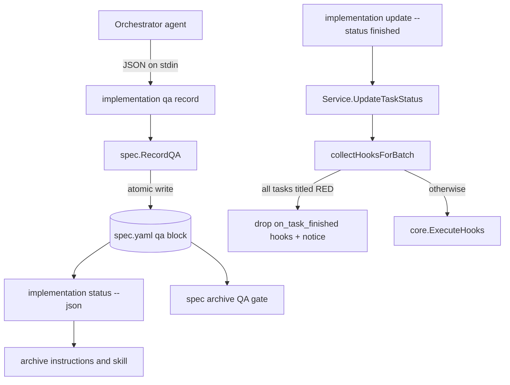

# Technical Design: Persist QA Report and Scoped Hooks for RED Tasks

## 1. Architecture Blueprint



## 2. Persistence & Data Modeling
`spec.yaml` gains an optional top-level `qa` block (omitted when never recorded). Only the latest report is kept.

- **Schema Changes (YAML, snake_case keys):**
  - `qa.status`: `PASSED` | `FAILED` (derived by the CLI, never supplied by the caller).
  - `qa.run`: integer, starts at 1, incremented on each replacement.
  - `qa.recorded_at`: UTC RFC3339 timestamp.
  - `qa.criteria[]`: `id` (string, e.g. `US-1.2`), `scenario` (string), `evidence` (string), `verdict` (`PASSED` | `FAILED` | `NOT-VERIFIABLE`).
  - `qa.findings[]`: `title` (string, required), `detail` (string, optional).
- **Constraints:** `criteria` has 1 to 200 entries; every `id`, `scenario` and `verdict` is non-empty; verdict values are case-sensitive exact; `findings` may be empty; each text field is capped at 2000 characters.
- **Preservation:** loading and saving goes through `LoadMetadata`/`SaveMetadata`, so `time_logs`, `refinement` and `delta` are rewritten unchanged. `SaveMetadata` already writes with mode `0600`; the write is made atomic (temp file in the same directory, then rename) inside `SaveMetadata`.

## 3. API & Interfaces (The Contract)
All commands are non-interactive CLI commands run directly by `specforce`.

- **Command:** `specforce implementation qa record <slug>`
  - **Input (stdin, JSON):**
    ```json
    {
      "criteria": [
        {"id": "US-1.1", "scenario": "Record a report", "evidence": "go test ./... output line", "verdict": "PASSED"}
      ],
      "findings": [
        {"title": "Out-of-scope observation", "detail": "optional text"}
      ]
    }
    ```
  - **Success (exit 0):** one line `[OK] QA report recorded for <slug>: <STATUS> (P passed, F failed, N not-verifiable, K findings, run R)`.
  - **Errors (exit non-zero, nothing written):** unknown slug or archived slug; empty stdin; invalid JSON; unknown field; zero criteria; more than 200 criteria; invalid verdict (message names the criterion `id`); empty required field; text over the cap.
- **Command:** `specforce implementation status <slug> --json` gains an optional `qa` object:
  ```json
  {"qa": {"status": "FAILED", "run": 2, "recorded_at": "2026-10-24T10:00:00Z",
          "counts": {"passed": 3, "failed": 1, "not_verifiable": 1},
          "failed_criteria": [{"id": "US-1.1", "scenario": "..."}],
          "not_verifiable_criteria": [{"id": "US-2.3", "scenario": "..."}],
          "findings": [{"title": "...", "detail": "..."}]}}
  ```
  The key is absent when no report is stored. When the `qa` block cannot be parsed, the key `qa_error` carries the message and task data is still returned.
- **Command:** `specforce spec archive <slug> [--force]`
  - New QA gate, evaluated after the pending-task check and the delta gate: stored status `FAILED` returns an error listing each failed criterion (`<id> - <scenario>`) and the text `fix the work, run the QA tester again and re-record with specforce implementation qa record <slug>`; `--force` does not bypass it. No stored report prints the warning `no QA report recorded for <slug>; archiving without QA evidence` and continues. Unreadable `qa` block returns an error.
- **Command:** `specforce implementation update <slug> --task <ids> --status finished` (existing)
  - When every task id in the batch has a title containing the exact token `[RED]` and `on_task_finished` is non-empty, those hooks are dropped from the batch and the CLI prints `[WARN] RED task: skipped per-task hooks: <hook1>; <hook2>` before the `[OK]` line. Phase and all-tasks hooks are collected as before. Any other batch runs hooks exactly as today.

## 4. File & Component Inventory

**Backend (Go, module `github.com/jeancodogno/specforce-kit`):**
- `[src/internal/spec/metadata.go]` -> `Metadata` gains field `QA *QAMetadata` with tags `json:"qa,omitempty" yaml:"qa,omitempty"`; `SaveMetadata` writes through a temp file plus `os.Rename` (mode `0600`).
- `[src/internal/spec/qa.go]` (new) -> types `QAMetadata`, `QACriterion`, `QAFinding`, `QAInput`; constants `QAStatusPassed`, `QAStatusFailed`, verdict constants; `ParseQAInput(r io.Reader) (*QAInput, error)` (strict decoding via `DisallowUnknownFields`, size limit 1 MiB); `ValidateQAInput`; `RecordQA(ctx, projectRoot, slug string, in *QAInput) (*QAMetadata, error)` (rejects archived or missing specs, derives status, increments `run`, sets `recorded_at`); `SummarizeQA(meta *QAMetadata) *QASummary`.
- `[src/internal/spec/implementation.go]` -> `ImplementationReport` gains `QA *QASummary` (`json:"qa,omitempty"`) and `QAError string` (`json:"qa_error,omitempty"`); helper `IsRedTask(title string) bool` returns true when the title contains the exact token `[RED]`.
- `[src/internal/spec/service.go]` -> `GetImplementationStatus` fills `QA`/`QAError` from `LoadMetadata`; `collectHooksForBatch` is extended to return the skipped per-task hooks; new method `UpdateTaskStatusDetailed(ctx, projectRoot, slug, taskIDs, status) ([]string, error)` returns skipped hooks; `UpdateTaskStatus` remains as a thin wrapper that ignores the skipped list.
- `[src/internal/spec/archive.go]` -> new `CheckQAGate(projectRoot, slug string) (QAGateResult, error)` returning one of `missing`, `passed`, `failed` plus the failed criteria; `ArchiveSpec` is unchanged.
- `[src/internal/cli/implementation.go]` -> `HandleImplementationUpdate` calls `UpdateTaskStatusDetailed` and prints the RED warning through `ui.Warn`; new `HandleImplementationQA(ctx, ui, args...)` and `HandleImplementationQARecord(ctx, ui, slug string, in io.Reader)`.
- `[src/internal/cli/spec.go]` -> `HandleSpecArchive` calls a new `enforceQAGate(ctx, ui, projectRoot, slug)` after `enforceDeltaGate`.
- `[src/internal/cli/cobra/implementation.go]` -> new `implementationQACmd` (group) with subcommand `record [slug]` (`cobra.ExactArgs(1)`), registered under `implementationCmd`.
- `[src/internal/tui/implementation.go]` -> `RenderImplementationStatus` shows a QA line (status and counts, or "QA: not recorded").

**Kit blueprints and instructions:**
- `[src/internal/agent/kit/instructions/archive.md]` -> archive preflight reads the `qa` object from `specforce implementation status <slug> --json`, refuses on `FAILED` listing failed criteria, warns on absence, and passes `qa.findings` and `not_verifiable_criteria` to the next-step derivation.
- `[src/internal/agent/kit/skills/spf-archive/SKILL.yaml]` -> step 4 derives suggestions from the persisted `qa` object, no longer from the conversation.
- `[src/internal/agent/kit/skills/spf-implement/SKILL.yaml]` -> after the independent qa-tester returns, the orchestrator pipes the report JSON to `specforce implementation qa record <slug>` and repeats it after each correction cycle; the qa-tester charter keeps forbidding writes; RED tasks are finished with the same update command and the warning is expected.
- `[src/internal/agent/kit/skills/spf-spec/SKILL.yaml]` -> roadmap rule: RED tasks carry the `[RED]` token in their title.
- `[src/internal/agent/kit/kit.yaml]` -> unchanged unless a listed asset needs a new entry (verified by the manifest test).

**Tests (Go, same packages):**
- `[src/internal/spec/qa_test.go]`, `[src/internal/spec/service_test.go]`, `[src/internal/spec/archive_test.go]`, `[src/internal/spec/metadata_test.go]`, `[src/internal/cli/implementation_test.go]`, `[src/internal/cli/spec_test.go]`, `[src/internal/cli/cobra/root_test.go]` and the kit blueprint tests under `[src/internal/agent/]` cover every scenario of `[US-1]` to `[US-5]`.

**Module documents (updated by the delta at archive):**
- `.specforce/docs/modules/agent-kit.md` and `.specforce/docs/modules/spec-management.md`.
