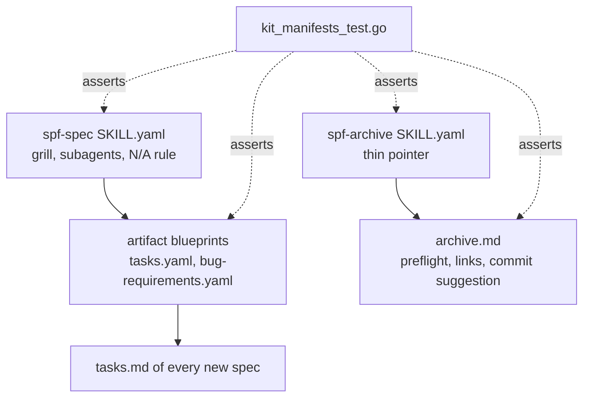

# Technical Design: Executable Criteria in Spec and Preflight/Closing Improvements in Archive

## 1. Architecture Blueprint

All changes are text edits to embedded prompt blueprints plus assertions in the existing manifest test file. No Go runtime logic, CLI command or data model changes.

## 4. File & Component Inventory

**Planning skill**
- `[src/internal/agent/kit/skills/spf-spec/SKILL.yaml]` -> `content` (US-4, US-5, US-6, US-7); line count stays at or below 155 (currently 147), by folding text into existing sections:
  - Critical Rule 1: replace the literal `N/A` in the placeholder list with the rule "omit a section that does not apply or keep it with a one-line justification; unresolved markers (`TBD`, `TODO`, bare `N/A`) remain forbidden".
  - Critical Rule 5: keep the ban on external planning sub-threads; add the exception that `large`/`complex` grounding MAY delegate strictly read-only exploration to helpers that return findings, while interview, decisions and artifact writing stay in the main session.
  - Step 1A: `proposal.md` decisions listed as taken are restated for a single confirmation and only open questions and newly found gaps are asked; a taken decision contradicting the Constitution or code is raised as a question with a recommendation.
  - Step 1C: questions go in waves of at most 4, each with a recommendation listed first; "approve all recommendations" confirms that wave only and never carries to later waves; the hard gate stays.
  - Step 2 / Step 3: a single pointer sentence stating that task acceptance checks must be non-interactive commands and that `bug` specs follow their artifact blueprint (the details live in the artifact blueprints).

**Artifact blueprints (read through `specforce spec artifact`)**
- `[src/internal/agent/artifacts/spec/tasks.yaml]` -> `instruction` and `template` (US-1, US-2, US-3):
  - Instruction 3 (TDD-First Verification) extended: every Acceptance Check is a single non-interactive command or test scenario with an observable expected result, runnable in under 2 minutes, no prompts, manual clicks or pasted secrets; a criterion needing human judgment is rewritten into a scriptable check or marked in the task as not verifiable by a tester.
  - New instruction: for `large`/`complex` specs the last phase is `### Phase {N}: Black-box Verification`, one task per scenario, each tracing to `[US-x]` with command and expected observable result; `small`/`medium` omit it.
  - New instruction: for `bug` specs, task T1.1 creates the regression test and states that it fails before the fix; no fix task precedes it.
  - Template: add a final `Black-box Verification` phase example, marked as rendered only for `large`/`complex`.
- `[src/internal/agent/artifacts/spec/bug-requirements.yaml]` -> `instruction` (US-3): Reproduction Mandate and RCA become mandatory and concrete; if the root cause is not established, halt and ask the user or recommend discovery instead of guessing; acceptance criteria must map to the first RED regression task.

**Archival**
- `[src/internal/agent/kit/instructions/archive.md]` -> existing sections (US-8, US-9); stays below 100 lines (currently 92):
  - Step 1 (Verification of Completion): keep the status command; on progress below 100% (including blocked or unfinished tasks) stop BEFORE any retrospective, Constitution or module change, list each pending task as `T<id> - <title> - <state>` from the status output, point to `/spf:implement`, and refuse even if the user asks to archive anyway. No file write happens before this check passes.
  - Step 7 (Handoff) format: add `**Artifacts:**` clickable links to the archived `requirements.md`, `design.md`, `tasks.md` under `.specforce/archive/<slug>/` (only those that exist), changed module documents as links (existing delta line stays), and a `### Suggested Commit Message` code block holding one conventional commit message (type(scope): summary) placed after the module line and before the next steps; state that no module changed when applicable.
  - Guardrails: add "Suggest, never run, a commit; no version-control command is executed".
- `[src/internal/agent/kit/skills/spf-archive/SKILL.yaml]` -> `content`: one-line pointer that completion refusal and the summary format (links, commit suggestion) are defined by the retrieved instructions; keeps `Suggest Next Steps & Follow-up Specs` and `/spf:discovery`.

**Interview skill**
- `[src/internal/agent/kit/skills/consultative-grill/SKILL.yaml]` -> `content` Interview Rules (US-5): the single-question rule becomes waves of at most 4 with the recommendation first (approve-all covers one wave); decision persistence applies once artifacts are written, consistent with the hard gate.

**Tests**
- `[src/internal/agent/kit_manifests_test.go]` -> new `TestKitManifests_ExecutableCriteriaAndArchivePreflight` with subtests using the existing `assertFileContains` helper plus targeted negative assertions:
  - Spec skill: contains the read-only exploration exception, the "restated for a single confirmation" proposal rule, the "approve all recommendations" wave rule including "never carries", the omit-or-justify rule; does NOT contain the old list item `N/A` among forbidden placeholders (assert the substring ``(`TBD`, `A definir`, `Dúvidas`, `N/A`, `TODO`)`` is absent); line count at most 155.
  - `tasks.yaml`: contains non-interactive acceptance check rule, `Black-box Verification`, the `large`/`complex` condition, and the first-task failing regression rule for `bug`.
  - `bug-requirements.yaml`: contains the halt-on-unknown-root-cause rule and the RED regression link.
  - `archive.md`: contains the pending-task listing, the refusal before any retrospective, the "even if the user asks" refusal, the archived-location links, the `Suggested Commit Message` block, and the no-version-control-command guardrail; the Step 1 refusal appears before the `Dynamic Agent & Skill Discovery` step (ordering assertion by index).
  - `spf-archive/SKILL.yaml`: still contains the pointer and `Suggest Next Steps & Follow-up Specs`.
  - Existing assertions (including `TestLifecycleCommandNaming` prefix rules) stay green: all new hand-off commands use the `/spf:` prefix.

## 5. Module Delta Surface
`agent-kit` module only: new business rules for executable criteria, bug spec ordering, planning interview behavior, and archive preflight/closing; new use cases mirroring US-1..US-9. Recorded in `deltas/agent-kit.md`.

## 6. Risks and Constraints
- Existing exact-text assertions on `spf-spec` and `archive.md` must keep passing; edits are additive or replace only the `N/A` list item and Step 1/Step 7 sentences not asserted by tests.
- Constitution unchanged: read-only exploration helpers are consistent with the "Primary Orchestration Only" principle because planning, interview and writing remain in the main loop.
- Requirements stay free of technical detail (BR-KIT-02); command names and file paths live only here and in tasks.
