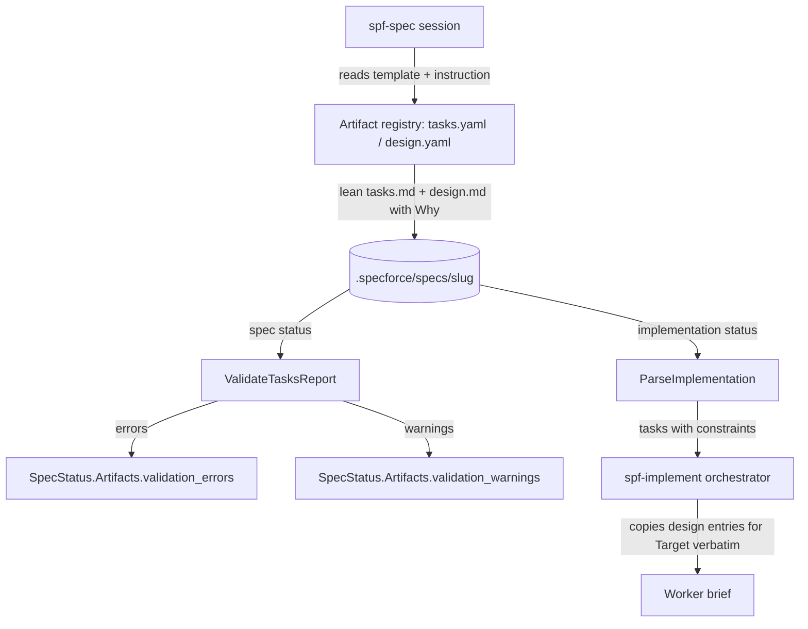

# Technical Design: Lean Tasks, Design-Anchored Decisions

## 1. Architecture Blueprint



## 3. API & Interfaces (The Contract)

### `specforce spec status <slug> --json`
- **AuthZ / Roles:** Local CLI, no roles.
- **Response (`200 OK`):** each artifact entry gains an optional list, omitted when empty:
```json
{
  "name": "feature-tasks",
  "validation_errors": ["Task T1.1 (line 12) is missing mandatory **Acceptance Check:** section"],
  "validation_warnings": ["Task T2.3 (line 40) contains a fenced code block", "Task T3.2 (line 71) cites 5 distinct file paths (limit 3)"]
}
```
  Why: a separate list keeps `validation_errors` and `is_valid` semantics untouched, so warnings can never flip validity.
- **Rules:** `is_valid`, `progress` and the exit outcome ignore `validation_warnings`. Human output prints warnings after errors, marked as warnings.

### `specforce implementation status <slug> --json`
- **Response (`200 OK`):** each task replaces `action_steps` with `constraints` (array of strings, empty when the task has none):
```json
{ "id": "T1.1", "target": "src/x.go", "context": "[US-1]", "constraints": ["Keep legacy heading accepted"], "verification": "go test ./..." }
```
  Why: the field name must match the heading authors now write; reading a legacy `**Action Steps:**` block fills the same list, so old specs need no migration.

### Task block grammar (tasks.md)
- Mandatory per task: title line, `**Target:**`, `**Acceptance Check:**`; `**Context:**` mandatory for medium, large and complex (unchanged).
- Optional: `**Constraints:**` with `- ` items, or the legacy `**Action Steps:**` with `- ` items; both accepted, no minimum or maximum count; an empty block is accepted.
- Warnings (non-blocking): a task block containing a fenced code block; a task whose `**Target:**` plus constraint items cite more than 3 distinct paths. A path is a backtick-quoted token with no spaces that contains `/`.
  Why: the kit is language-agnostic, so path detection avoids extensions and parses nothing language-specific.

### Design template rule (design.md)
- A contract or an inventory entry may carry one `Why:` line for a non-obvious decision. No dedicated rationale section, no alternatives debate.
  Why: decisions need one authoritative home that tasks can point to; the inventory and contracts are where an implementer already looks.

## 4. File & Component Inventory

**Backend:**
- `[src/internal/spec/tasks.go]` -> `taskBlock`, `taskValidationState`, `updateTaskBlockState`, `validateLastTask`: add `hasConstraintHeader`, treat `**Constraints:**` and `**Action Steps:**` as the same optional list, delete the "missing Action Steps" and "action density" errors, collect `warnings` (fenced block, path count) per task; add `ValidateTasksReport(ctx, projectRoot, slug) (TaskValidation, error)` returning `{Errors, Warnings}` and keep `ValidateTasks` as a wrapper returning only errors.
  Why: keeping `ValidateTasks` avoids breaking its other callers and tests while the new report is adopted.
- `[src/internal/spec/status.go]` -> `ArtifactStatus`, `processArtifactStatus`: add `ValidationWarnings []string` (`json:"validation_warnings,omitempty"`), call `ValidateTasksReport`, and update `validationGuide` to the lean example without Action Steps.
- `[src/internal/spec/implementation.go]` -> `ImplementationTask`, parser around the `task.ActionSteps = append(...)` site: rename the field to `Constraints` (`json:"constraints"`), populate from either heading, never fail when the block is absent.
- `[src/internal/tui/spec.go]` -> `RenderSpecStatus` (called from the CLI status command):  print `validation_warnings` after errors, flagged as warnings, with no effect on the exit outcome.
- `[src/internal/agent/artifacts/spec/tasks.yaml]` -> rewrite `instruction` and `template`: replace the Action Density and Directive Logic rules with Lean Task rules (optional `**Constraints:**` only for non-deducible items, no signatures/constants/snippets, reference design decisions instead of repeating them); reword the Determinism Mandate to "no placeholders, no scope ambiguity"; change the template and the black-box phase example to omit the step block.
- `[src/internal/agent/artifacts/spec/design.yaml]` -> `instruction` rules 1 and 4: allow a one-line `Why:` on non-obvious decisions inside contracts and inventory entries, keep the ban on alternatives debate and on new sections, and declare the design as the only place for code-symbol anchors; template gains a `Why:` example line.
- `[src/internal/agent/kit/skills/spf-implement/SKILL.yaml]` -> Mission Brief block "TASK BATCH STEPS": replace `Action Steps: {action_steps}` with `Constraints: {constraints}` (line omitted when empty) and add a directive that the orchestrator copies, verbatim, the design inventory entries, related contracts and `Why:` lines that concern each task's Target, naming the design source, or states that none applies.
  Why: the excerpt is picked by the orchestrator from the design instead of by Go code, because contracts are keyed by endpoint and not by file, so a path match would miss them.
- `[src/internal/agent/kit/skills/spf-spec/SKILL.yaml]` -> planning step text that mentions action step density: align with the Lean Task rules and the `Why:` guidance.
- `[.claude/skills/*]`, `[.agents/skills/*]` -> regenerated copies of the changed skills through the existing sync flow, not edited by hand.
- `[.specforce/docs/engineering.md]` -> "Self-Containment Mandate": amend only after explicit owner approval, to require self-containment in business rules, intent and decisions, and to limit symbol-level anchors to the design and to non-obvious constraints.
- `[.specforce/docs/modules/spec-management.md]`, `[.specforce/docs/modules/agent-kit.md]` -> updated at archive through the sealed deltas in `deltas/`.

**Tests:**
- `[src/internal/spec/tasks_validation_test.go]` -> replace the 23 Action-Steps expectations with: task without steps accepted, legacy heading accepted, empty block accepted, mixed headings accepted, missing Acceptance Check still rejected, warning cases for fenced block and for 4 versus 3 paths.
- `[src/internal/spec/status_test.go]`, `[src/internal/spec/implementation_test.go]` -> assert `validation_warnings` presence/omission, `is_valid` unaffected, and `constraints` filled from both headings and empty when absent.
- `[src/internal/cli/integration_test.go]` -> update the JSON and rendering expectations.
- `[src/internal/agent/kit_manifests_test.go]` -> assert the planning blueprints no longer demand action density and the implement brief carries the verbatim-design directive.
