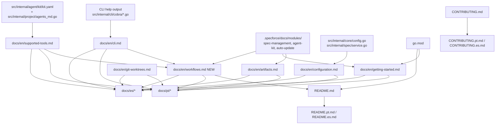

# Technical Design: Documentation Refresh for 1.0.0-beta.3

## 1. Architecture Blueprint
Documentation is derived from four sources of truth. English pages are written first from those sources; Portuguese and Spanish pages are translated from the final English pages only.



## 3. Interfaces (Documentation Contracts)

### 3.1 Skill naming convention (all pages)
- Pages refer to skills by their neutral name: `spf.discovery`, `spf.constitution`, `spf.spec`, `spf.implement`, `spf.archive`. `consultative-grill` is mentioned only as an internal helper of planning.
- Each first mention on a page links to `supported-tools.md#invoking-skills` (same language folder).
- Examples of chat requests are plain language, e.g. "Use spf.spec to plan: add CSV export to reports".
- The legacy form `/spf:<name>` never appears.
  Why: skills are installed as `spf-<name>` folders with display name `spf.<name>` (`src/internal/agent/translator.go` -> skill header writes `name:` from `bp.Metadata.Name`), and invocation differs per tool.

### 3.2 Invocation table (`supported-tools.md`, section `## Invoking skills`)
Columns: `Tool | Install folder | Explicit invocation | Notes`. One row per tool key in `kit.yaml`:

| Tool key | Name | Install folder (from `kit.yaml` `target` + `skills`) |
|---|---|---|
| `claude` | Claude Code | `.claude/skills/` |
| `qwen` | Qwen | `.qwen/skills/` |
| `kimi-code` | Kimi Code | `.kimi/skills/` |
| `open-code` | OpenCode | `.opencode/skills/` |
| `kilo-code` | KiloCode | `.kilocode/skills/` |
| `codex` | Codex | `.codex/skills/` plus prompts `spf-*.md` in `${CODEX_PROMPTS_DIR:-${CODEX_HOME:-~/.codex}/prompts}` |
| `antigravity` | Antigravity | `.agents/skills/` |
| `cursor` | Cursor | `.cursor/skills/` |

- The "Explicit invocation" cell is filled only with a syntax confirmed in the tool's official documentation (skills / slash commands / custom prompts page) during implementation; the consulted page is recorded in the implementer's out-of-scope findings report, not in the docs. When no syntax is confirmed, the cell reads "Ask by name in chat (e.g. 'use spf.spec ...')".
- Codex Notes cell states the global write (`security.global_write: true` in `kit.yaml`) and the environment variables `CODEX_PROMPTS_DIR` / `CODEX_HOME`.
- Automated configuration section states: only `.claude/rules/AGENTS.md` is created as a symlink to the root `AGENTS.md` (`src/internal/project/agents_md.go` -> `ensurePlatformConfigs`, map `agentMappings` has only `.claude`); legacy `.agents/**/rules/AGENTS.md` symlinks are removed (`CleanupLegacySymlinks`); Cursor reads the root `AGENTS.md` natively. The `AGENTS.md` managed block between `SPECFORCE_AGENTS_START/END` markers preserves user content outside it.
- `specforce init [agents...]` accepts the tool keys above to skip the interactive picker.

### 3.3 Workflow guide page contract (`docs/<lang>/workflows.md`)
Page skeleton:
```
[ language selector ]
# Workflows & Tips
Intro (≤5 lines) + "How to read the workflows" legend
## Workflows
### 1. Prototype in discovery before implementing
### 2. Fix a bug with a failing test first
### 3. Make a small change
### 4. The scope grew: resize the spec
### 5. Change after implementing, before archiving
### 6. Change after archiving: follow-up spec
### 7. QA failed
### 8. Parallel specs across worktrees
### 9. Adopt Specforce in an existing project
### 10. Resume an interrupted implementation
### 11. Switch AI tools mid-project
### 12. Enforce TDD through configuration
## Common situations
### <symptom> (×10)
```
Workflow block contract (identical order in every workflow):
1. `**When to use:**` one or two lines.
2. Numbered steps. Every step starts with exactly one label:
   - `💻 **Terminal:**` followed by a fenced `bash` block (human commands only).
   - `💬 **Agent chat:**` followed by a fenced `text` block with a plain-language request.
3. Optional `<details><summary>Behind the scenes</summary> ... </details>` describing what the agent runs (CLI commands may appear here, inside inline code, never in a `bash` block).
4. `**If it goes wrong:**` 1–3 bullets, linking to a `## Common situations` entry when one applies.

Allowed commands in `💻 Terminal` blocks (allow-list): `specforce init`, `specforce init <tool-keys...>`, `specforce console`, `specforce spec list`, `specforce spec status <slug>`, `specforce implementation status <slug>`, `specforce spec delta check <slug>`, `npm i -g @jeancodogno/specforce-kit`, `npm install -g @jeancodogno/specforce-kit@<version>`, `git worktree add ...`, `git status`.

Chat first: the agent reports task status, delta state and QA results itself, so workflows and common situations never ask the reader to run `spec status`, `implementation status` or `spec delta check`; they stay on the allow-list only for readers who want to look themselves. The agent also picks and changes the spec size, so no request names a size or asks for a resize.
Why: the reader gets lost when told to check state the agent already reports.

Example requests use one running invoicing SaaS (`csv-export`, `invoice-date-filter`, `invoice-due-date-column`, `csv-export-date-range`) instead of placeholders; generic `<slug>` stays only in the legend and in Common situations.
Why: a concrete request shows the reader how much detail to give.

Common situation entry contract: `**Symptom:**`, `**Why:**`, `**What to do:**` (the action is a terminal command from the allow-list or a chat request). The 10 symptoms and their source rules:

| Symptom | Source rule |
|---|---|
| Archive refused: pending tasks | BR-KIT-24, `--force` scope (BR-SPEC-07) |
| Archive refused: delta missing or pending | BR-SPEC-05, BR-SPEC-07, delta states in `src/internal/cli/cobra/spec.go` -> `specDeltaCheckCmd` |
| Delta base conflict | BR-SPEC-06, BR-KIT-18 |
| Archive refused: QA FAILED | BR-SPEC-11, BR-KIT-27 |
| Archive warning: no QA report | BR-SPEC-11 |
| Hook failure blocks a task | `hooks` in `src/internal/core/config.go` -> `HooksConfig`; BR-SPEC-12 for RED |
| Agent wants to code without a spec | AGENTS.md direct-edit prohibition; BR-KIT-14 |
| Worker returns a BLOCKED question | BR-KIT-14 |
| Resize during implementation | BR-SPEC-03 |
| Edit an approved spec | Principles Golden Rule 1; AGENTS.md "Total Consistency" |

Workflow source rules: 1 → BR-KIT-30..33; 2 → BR-KIT-21, `spec init --type bug`; 3 → BR-SPEC-02 (`small` = tasks only, delta exempt); 4 → BR-SPEC-03; 5 → Golden Rule 1 + Total Consistency (update requirements/design/delta/tasks, implement new tasks only); 6 → BR-KIT-10 next steps, MODIFIED delta blocks; 7 → BR-KIT-12 (≤2 correction cycles), BR-SPEC-11; 8 → `git-worktrees.md` read-only rules + BR-SPEC-06 seal; 9 → `spf.constitution` on existing code; 10 → BR-KIT-16; 11 → constitution and specs are tool-independent, run `specforce init <new-tool-key>`, with a warning that every installed tool left out has its whole folder deleted without confirmation (`src/internal/project/service.go` -> `os.RemoveAll`); 12 → `instructions.tasks` example from `.specforce/config.yaml` + BR-KIT-28.

### 3.4 CLI reference contract (`cli.md`)
Grouped sections, no audience labels: Global (`init [agents...]`, `console`), Global flags & environment (`--dev` for kit contributors, `-v/--version`, `DEBUG=1`, `completion`), Constitution (`status [--json]`, `artifact <name> [--json]`), Specification (`init <slug> [--type feature|bug] [--size small|medium|large|complex] [--json]`, `list [--json]`, `status <slug> [--json]`, `artifact <name> [--json]`, `resize <slug> --size <size> [--json]`, `audit <slug> [--valid|--invalid] [--error <msg>] [--clear] [--iteration <n>] [--json]`, `archive <slug> [--force]`), Delta (`delta check`, `delta seal`, existing text kept), Implementation & QA (`status <slug> [--json]`, `update <slug> --task <id>[,<id>...] --status <status>` with repeated `--task`, `qa record <slug>` reading a JSON report on standard input), Archive (`instructions`). Source: `src/internal/cli/cobra/*.go` flag registrations; descriptions taken from each command's `Short`/`Long`.
- `archive --force`: overrides only the pending-tasks check; never bypasses delta verification nor a FAILED QA (BR-SPEC-07, BR-SPEC-11).
- `update` finishing tasks runs hooks once per batch; all-RED batches skip only per-task hooks (BR-SPEC-12).

### 3.5 Artifacts page contract (`artifacts.md`)
Sections in order: 1 Constitution (`.specforce/docs/`: principles, architecture, ui-ux, security, engineering, governance, `modules/`); 2 Spec package (`.specforce/specs/<timestamp>-<slug>/`: `spec.yaml`, `proposal.md` optional from discovery, `requirements.md`, `design.md`, `tasks.md`, `deltas/<module>.md`); 3 Sizes table (BR-SPEC-01/02, default `medium`); 4 Bug specs (`bug-requirements`/`bug-design` templates in `src/internal/agent/artifacts/spec/`, regression RED task first); 5 Task format (target + single executable acceptance check, optional constraints, no verification-only tasks, `## Black-box Scenarios` section mandatory for large/complex — BR-KIT-20/35); 6 Module deltas (ADDED/MODIFIED/REMOVED, `NEW:` keys, `delta.impact: none`, seal, states none/exempt/missing/pending/applied/invalid); 7 QA report (verdicts, stored in `spec.yaml`, archive gate); 8 Test-first RED tasks; 9 `.specforce/` folder (`config.yaml`, `archive/`, `scratch/` self-ignored discovery evidence).

### 3.6 Configuration page additions (`configuration.md`)
- Instruction keys accepted: any artifact name — generic `requirements`, `design`, `tasks`, `implementation`, `archive`, and prefixed variants such as `bug-requirements`, `bug-design`; resolution combines generic then specific without duplicates (`src/internal/spec/service.go` -> `resolveInstructions`, `inferBaseType`).
- Replace the Portuguese example strings with English ones.
- Hook flow wording: Specforce runs hooks when the agent marks tasks finished; a non-zero exit blocks the transition and returns the output.

### 3.7 Getting-started additions
- Prerequisites: Go 1.26+ (from `go.mod` `go 1.26.4`).
- New `## Updates` section from `.specforce/docs/modules/auto-update.md` (BR-UPD-01, 03, 06, 11, 12; surfaces: `DEBUG=1`, `~/.specforce/state.json`, manual commands `npm install -g @jeancodogno/specforce-kit@<version>` and release download / `sudo make install`).
- Lifecycle section reordered to Constitution → Discovery → Spec → Implement → Archive, skill names per 3.1, link to `workflows.md`.
- Remove `gemini` example; use "start your AI agent".

## 4. File & Component Inventory

**English (source of truth):**
- `docs/en/workflows.md` -> NEW; workflows, tips and common situations per 3.3.
- `docs/en/supported-tools.md` -> tool list (8), `## Invoking skills` table, automated configuration per 3.2.
- `docs/en/cli.md` -> complete reference per 3.4.
- `docs/en/artifacts.md` -> lifecycle concepts per 3.5.
- `docs/en/configuration.md` -> instruction keys, English examples per 3.6.
- `docs/en/getting-started.md` -> Go version, Updates, lifecycle order per 3.7.
- `docs/en/git-worktrees.md` -> remove the stray `slug/lens` frontmatter block after the language selector; mention delta sealing for parallel specs touching the same module.
- `README.md` -> remove Gemini (list and `.gemini/GEMINI.md` example), add Cursor, Go 1.26+, lifecycle order with sequential numbering, neutral skill names linking to `docs/en/supported-tools.md#invoking-skills`, add `workflows.md` to the docs list, remove the duplicated trailing license fragment.
- `CONTRIBUTING.md` -> replace `/spf:*` with neutral skill names; replace "`SKILL.md`, `commands.md`" with the skill blueprint model (`src/internal/agent/kit/skills/<id>/SKILL.yaml` + tool entry in `kit.yaml`).

**Translations (from final English):**
- `docs/pt/{workflows,supported-tools,cli,artifacts,configuration,getting-started,git-worktrees}.md` -> Portuguese mirror.
- `docs/es/{workflows,supported-tools,cli,artifacts,configuration,getting-started,git-worktrees}.md` -> Spanish mirror.
- `README.pt.md`, `README.es.md` -> mirror of README changes.
- `CONTRIBUTING.pt.md`, `CONTRIBUTING.es.md` -> full translation of the corrected `CONTRIBUTING.md`.
  Why: both files currently hold English text, so they are translated, not patched.

**Untouched:** `AGENTS.md`, `.specforce/docs/**`, skill blueprints, all Go sources.
