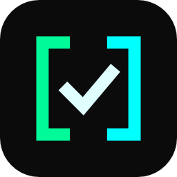

<p align="center">
  <a href="https://github.com/jeancodogno/specforce-kit/">
    <picture>
      <source media="(prefers-color-scheme: dark)" srcset="https://raw.githubusercontent.com/jeancodogno/specforce-kit/main/assets/brand/lockup-dark-256.png">
      <source media="(prefers-color-scheme: light)" srcset="https://raw.githubusercontent.com/jeancodogno/specforce-kit/main/assets/brand/lockup-light-256.png">
      
    </picture>
  </a>
</p>
<p align="center">Spec-Driven Development para agentes de IA.</p>

# Specforce

<p align="center">
  <a href="https://github.com/jeancodogno/specforce-kit/releases"></a>
  <a href="https://github.com/jeancodogno/specforce-kit/actions/workflows/ci.yml"></a>
  <a href="https://goreportcard.com/report/github.com/jeancodogno/specforce-kit"></a>
  <a href="https://www.npmjs.com/package/@jeancodogno/specforce-kit"></a>
  <a href="go.mod"></a>
  <a href="https://github.com/jeancodogno/specforce-kit/issues"></a>
  <a href="https://github.com/jeancodogno/specforce-kit/pulls"></a>
  <a href="LICENSE"></a>
</p>

<p align="center">
  <a href="README.md"></a>
  <a href="README.pt.md"></a>
  <a href="README.es.md"></a>
</p>

> **La capa de orquestación para la ingeniería nativa de IA.**

Specforce Kit es un framework de nivel profesional diseñado para coordinar agentes de IA (Claude Code, Cursor, Codex, KiloCode y más) a través del **Desarrollo Orientado por Especificaciones (SDD, Spec-Driven Development)**. Proporciona las **Skills**, la **Constitución** y las **Herramientas de Orquestación** estandarizadas necesarias para transformar la IA de un asistente "basado en vibras" en una fuerza de ingeniería determinista.

---

## 🧠 Filosofía

En la era de la IA, la implementación es un commodity, pero el diseño es una responsabilidad. **La implementación sin una especificación está estrictamente prohibida en Specforce.**

El Desarrollo Orientado por Especificaciones (SDD) desacopla el diseño de la implementación. Una especificación actúa como un contrato estricto entre los diseñadores humanos y los ejecutores máquina. Así evitamos el "vibe coding" (la acumulación de decisiones improvisadas y no verificadas), garantizando que tu sistema siga siendo coherente, seguro y mantenible sin importar qué agente de IA escriba el código.

---

## 📊 ¿Por qué usar Specforce?

Programar con IA sin barreras estrictas conduce inevitablemente al "vibe coding": prompts vagos, resultados impredecibles y una montaña de deuda técnica que crece rápidamente. Aunque otras herramientas intentan resolverlo, a menudo te obligan a entrar en nuevos ecosistemas de IDE, requieren configuraciones pesadas o inflan la ventana de contexto de tu IA.

Specforce está diseñado para ser la **capa de orquestación invisible**. Aporta previsibilidad, control arquitectónico y verificación estricta a tus flujos de trabajo con IA, actuando como una máquina de estados activa y no solo como una colección de plantillas estáticas.

### Fortalezas clave:

- **Constitución segmentada**: en lugar de un único prompt enorme, las reglas se dividen en dominios especializados (Arquitectura, UI/UX, Seguridad). El agente solo carga el contexto exacto que necesita, manteniendo bajo el coste en tokens y reduciendo las alucinaciones.
- **Especificaciones con tamaño y deltas de módulo**: los cambios pequeños solo necesitan una lista de tareas; los más grandes añaden requisitos, diseño y un delta que mantiene al día las living specs de módulo.
- **QA independiente**: después de la implementación, un tester que no escribió código comprueba cada criterio de aceptación; un veredicto fallido bloquea el archivado.
- **Hooks de verificación dinámicos**: ejecuta tests, linters o scripts personalizados automáticamente antes de que un agente pueda marcar una tarea como finalizada.
- **Soporte para Git Worktrees**: descubre y visualiza de forma nativa especificaciones de varias ramas de git a la vez sin cambiar de contexto.
- **Instrucciones según el contexto**: inyecta reglas y restricciones específicas de forma dinámica según el artefacto o la fase en la que trabaja el agente.
- **Agnóstico respecto a la herramienta**: la Constitución y las especificaciones viven en `.specforce/`, no en archivos propios de cada herramienta, así que puedes cambiar de herramienta de IA sin perder el contexto del proyecto.
- **Ultrarrápido y sin dependencias**: se distribuye como un único binario, sin configuraciones pesadas de Python ni ecosistemas forzados para arrancar tu proyecto.

---

## 🤖 Uso del agente (Skills)

Specforce instala sus skills de forma nativa en tu herramienta de IA. Pide una skill por su nombre, en lenguaje natural, en el chat de tu agente; la sintaxis explícita de cada herramienta está en [Invocar las skills](docs/es/supported-tools.md#invocar-las-skills). Este es el ciclo de vida estándar:

### 1. La Constitución (`spf.constitution`)
**Ejemplo:** "Usa spf.constitution para configurar la constitución: {descripción del proyecto y stack}"

El primer paso en cualquier proyecto. Genera la Constitución de tu proyecto en `.specforce/docs/`: principios, arquitectura, UI/UX, seguridad, ingeniería, gobernanza y especificaciones de los módulos de dominio (`modules/`).
- **Segmentada:** Specforce mantiene sus propios documentos especializados en lugar de archivos de reglas propios de cada herramienta. El agente solo carga lo que necesita, y el contexto se mantiene intacto cuando cambias de herramienta.
- **Configuración interactiva:** describe la idea de tu proyecto y su stack. El agente hará preguntas aclaratorias para ayudarte a tomar las decisiones fundacionales.
- **Flexible:** ejecútala una vez para la configuración inicial, o vuelve a ejecutarla en cualquier momento para actualizar la constitución. Puedes usarla con ideas totalmente nuevas o dirigirla a un proyecto existente para analizar y documentar su arquitectura actual.

### 2. Discovery (`spf.discovery`)
**Ejemplo:** "Usa spf.discovery para investigar: {idea o reporte de bug}"

La fase de exploración. Úsala para hacer una lluvia de ideas sobre nuevas funcionalidades o investigar problemas técnicos antes de comprometerte con un plan.
- **Solo lectura para el código del producto:** el agente nunca edita tus archivos existentes. La evidencia desechable (tests, scripts, capturas de pantalla) vive en `.specforce/scratch/`.
- **Consultivo:** el agente da opiniones, compensaciones y opciones recomendadas, y encuentra las causas raíz de los bugs.
- **Formalización:** cuando estés listo, pídele que formalice el resultado en una propuesta que la planificación reutiliza.

### 3. Creación de una especificación (`spf.spec`)
**Ejemplo:** "Usa spf.spec para planificar: {descripción de lo que hay que añadir o modificar}"

¿Listo para construir? El agente aclara tus requisitos y escribe los artefactos requeridos por el tamaño de la especificación: `requirements.md`, `design.md`, `tasks.md` y los deltas de módulo. Tú los revisas y los apruebas.

### 4. Implementación (`spf.implement`)
**Ejemplo:** "Usa spf.implement para implementar {spec}"

Después de que apruebas la especificación, el agente sigue estrictamente las tareas planificadas, ejecuta tus hooks de verificación y termina con un paso de QA independiente que registra un veredicto para cada criterio de aceptación.

### 5. Archivado (`spf.archive`)
**Ejemplo:** "Usa spf.archive para archivar {spec}"

Una vez que la implementación está completa y verificada, el agente aplica los deltas de módulo a las living specs (`.specforce/docs/modules/`), actualiza la Constitución si es necesario y archiva la especificación. El archivado se rechaza mientras haya tareas pendientes, el delta no esté aplicado o el QA haya fallado.

Para flujos y consejos sobre bugs, redimensionamiento, cambios después de la implementación, QA fallido y otros casos límite, consulta [Flujos de trabajo y consejos](docs/es/workflows.md).

---

## ⚡ Puntos de contacto humanos

Mientras Specforce impulsa tus agentes de IA, las personas interactúan principalmente a través de dos comandos de terminal:

### 1. Inicialización del proyecto
Configura la gobernanza y las skills del agente para tu proyecto.
```bash
specforce init
```

### 2. La Consola (TUI)
Lanza el centro de mando para seguir en tiempo real la salud del proyecto, el progreso de las especificaciones y las implementaciones de los agentes.
```bash
specforce console
```

---

## 🛠️ Agentes y herramientas de IA soportados

Specforce Kit está diseñado para ser agnóstico respecto a la herramienta e instala sus skills de forma nativa para los asistentes de programación con IA más populares:

- **Claude Code** (Anthropic)
- **Qwen** (Alibaba)
- **Kimi Code** (Moonshot AI)
- **OpenCode**
- **KiloCode**
- **Codex**
- **Antigravity**
- **Cursor**

*¿No ves tu herramienta favorita? ¡Aceptamos PRs para añadir nuevos kits!*

---

## 🚀 Primeros pasos

### Instalación

**Usando NPM (recomendado)**
```bash
npm i -g @jeancodogno/specforce-kit
```

**Desde el código fuente (requiere Go 1.26+ y Make)**
```bash
git clone https://github.com/jeancodogno/specforce-kit.git
cd specforce-kit
make build
# Binary 'specforce' is created in the root.
# You can move it to your PATH manually or run it from here.
```

---

## 📚 Documentación

Para profundizar en Specforce Kit, consulta nuestra documentación oficial:

- [Primeros pasos y flujo de trabajo](docs/es/getting-started.md): configuración del entorno, primeros pasos, actualizaciones y el ciclo de vida recomendado del Desarrollo Orientado por Especificaciones.
- [Flujos de trabajo y consejos](docs/es/workflows.md): flujos paso a paso, consejos y qué hacer cuando un paso queda bloqueado.
- [Soporte para Git Worktrees](docs/es/git-worktrees.md): guía del descubrimiento de especificaciones entre ramas, la consola unificada y las restricciones de solo lectura.
- [Artefactos](docs/es/artifacts.md): los archivos generados (Constitución, Requisitos, Diseño, Tareas), los tamaños de especificación, los deltas de módulo y el informe de QA.
- [Configuración](docs/es/configuration.md): guía para personalizar hooks e instrucciones.
- [Referencia de la CLI](docs/es/cli.md): todos los comandos y flags de la terminal.
- [Herramientas soportadas](docs/es/supported-tools.md): agentes de IA soportados de forma nativa y cómo invocar las skills en cada uno.

---

## 🔍 Solución de problemas

### "command not found: specforce"
Si encuentras este error después de la instalación, normalmente significa que el directorio bin global de npm no está en el `PATH` de tu sistema.

**Solución para macOS/Linux:**
Añade la siguiente línea al perfil de tu shell (por ejemplo, `~/.zshrc` o `~/.bashrc`):
```bash
export PATH="$(npm config get prefix)/bin:$PATH"
```

**Solución para Windows:**
Asegúrate de que `%AppData%\npm` esté en tus variables de entorno.

Para una solución de problemas más detallada, consulta [Primeros pasos: Solución de problemas](docs/es/getting-started.md#solución-de-problemas).

---

## 🤝 Contribuir
¡Las contribuciones son bienvenidas! Consulta nuestro [CONTRIBUTING.es.md](CONTRIBUTING.es.md) para saber cómo añadir soporte para nuevos agentes de IA o mejorar los kits existentes.

---

## 📜 Licencia
Publicado bajo la **Licencia MIT**. Consulta [LICENSE](LICENSE) para más detalles.
