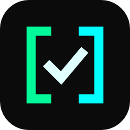

<p align="center">
  <a href="https://github.com/jeancodogno/specforce-kit/">
    <picture>
      <source media="(prefers-color-scheme: dark)" srcset="https://raw.githubusercontent.com/jeancodogno/specforce-kit/main/assets/brand/lockup-dark-256.png">
      <source media="(prefers-color-scheme: light)" srcset="https://raw.githubusercontent.com/jeancodogno/specforce-kit/main/assets/brand/lockup-light-256.png">
      
    </picture>
  </a>
</p>
<p align="center">Spec-Driven Development for AI agents.</p>

# Specforce

<p align="center">
  <a href="https://github.com/jeancodogno/specforce-kit/releases"></a>
  <a href="https://github.com/jeancodogno/specforce-kit/actions/workflows/ci.yml"></a>
  <a href="https://goreportcard.com/report/github.com/jeancodogno/specforce-kit"></a>
  <a href="https://www.npmjs.com/package/@jeancodogno/specforce-kit"></a>
  <a href="go.mod"></a>
  <a href="https://github.com/jeancodogno/specforce-kit/issues"></a>
  <a href="https://github.com/jeancodogno/specforce-kit/pulls"></a>
  <a href="LICENSE"></a>
</p>

<p align="center">
  <a href="README.md"></a>
  <a href="README.pt.md"></a>
  <a href="README.es.md"></a>
</p>

> **The Orchestration Layer for AI-Native Engineering.**

Specforce Kit is a professional-grade framework designed to coordinate AI agents (Claude Code, Cursor, Codex, KiloCode and more) through **Spec-Driven Development (SDD)**. It provides the standardized **Skills**, **Constitution**, and **Orchestration Tools** required to transform AI from a "vibe-based" assistant into a deterministic engineering force.

---

## 🧠 Philosophy

In the age of AI, implementation is a commodity, but design is a liability. **Implementation without a specification is strictly forbidden in Specforce.**

Spec-Driven Development (SDD) decouples design from implementation. A specification acts as a strict contract between human designers and machine executors. By doing so, we prevent "vibe coding" - the accumulation of ad-hoc, unverified decisions - ensuring your system remains coherent, secure, and maintainable no matter which AI agent writes the code.

---

## 📊 Why use Specforce?

AI coding without strict guardrails inevitably leads to "vibe coding": vague prompts, unpredictable outputs, and a rapidly accumulating mountain of technical debt. While other tools attempt to solve this, they often force you into new IDE ecosystems, require heavy setups, or bloat your AI's context window.

Specforce is designed to be the **invisible orchestration layer**. It brings predictability, architectural control, and strict verification to your AI workflows, acting as an active state machine rather than just a collection of static templates.

### Key Strengths:

- **Segmented Constitution**: Instead of a single massive prompt, rules are broken down into specialized domains (Architecture, UI/UX, Security). The agent only loads the exact context it needs, keeping token costs low and reducing hallucinations.
- **Sized Specs & Module Deltas**: Small changes need only a task list; larger ones add requirements, design and a delta that keeps the module living specs up to date.
- **Independent QA**: After implementation, a tester that wrote no code checks every acceptance criterion; a failed verdict blocks archiving.
- **Dynamic Verification Hooks**: Run tests, linters, or custom scripts automatically before an agent is allowed to mark a task as finished.
- **Git Worktree Support**: Natively discover and view specifications across multiple git branches simultaneously without switching contexts.
- **Context-Aware Instructions**: Inject specific rules and constraints dynamically based on the artifact or phase the agent is currently working on.
- **Tool Agnostic**: The Constitution and specs live in `.specforce/`, not in tool-specific files, so you can switch AI tools without losing project context.
- **Lightning Fast & Zero Dependencies**: Distributed as a single binary, requiring no heavy Python setups or forced ecosystems to bootstrap your project.

---

## 🤖 Agent Usage (Skills)

Specforce installs its skills natively in your AI tool. Ask for a skill by name, in plain language, in your agent's chat; the explicit syntax for each tool is in [Invoking skills](docs/en/supported-tools.md#invoking-skills). Here is the standard lifecycle:

### 1. The Constitution (`spf.constitution`)
**Example:** "Use spf.constitution to set up the constitution: {project description and stack}"

The first step in any project. This generates your project's Constitution in `.specforce/docs/`: principles, architecture, UI/UX, security, engineering, governance and domain module specifications (`modules/`).
- **Segmented:** Specforce keeps its own specialized documents instead of tool-specific rule files. The agent only loads what it needs, and the context stays intact when you switch tools.
- **Interactive Setup:** Describe your project idea and stack. The agent will ask clarifying questions to help you make foundational decisions.
- **Flexible:** Run it once to set up, or rerun it anytime to update the constitution. You can use it on brand new ideas or point it at an existing project to analyze and document its current architecture.

### 2. Discovery (`spf.discovery`)
**Example:** "Use spf.discovery to investigate: {idea or bug report}"

The exploration phase. Use this to brainstorm new features or investigate technical issues before committing to a plan.
- **Read-Only for Product Code:** The agent never edits your existing files. Disposable evidence (tests, scripts, screenshots) lives in `.specforce/scratch/`.
- **Consultative:** The agent gives opinions, trade-offs and recommended picks, and finds root causes for bugs.
- **Formalization:** When you are ready, ask it to formalize the result into a proposal that planning reuses.

### 3. Creating a Spec (`spf.spec`)
**Example:** "Use spf.spec to plan: {description of what to add or modify}"

Ready to build? The agent clarifies your requirements and writes the artifacts required by the spec size: `requirements.md`, `design.md`, `tasks.md` and the module deltas. You review and approve them.

### 4. Implementation (`spf.implement`)
**Example:** "Use spf.implement to implement {spec}"

After you approve the spec, the agent strictly follows the planned tasks, runs your verification hooks, and finishes with an independent QA step that records a verdict for every acceptance criterion.

### 5. Archiving (`spf.archive`)
**Example:** "Use spf.archive to archive {spec}"

Once implementation is complete and verified, the agent applies the module deltas to the living specs (`.specforce/docs/modules/`), updates the Constitution if needed, and archives the spec. Archiving is refused while tasks are pending, the delta is not applied, or QA failed.

For workflows and tips covering bugs, resizing, changes after implementation, failed QA and other edge cases, see [Workflows & Tips](docs/en/workflows.md).

---

## ⚡ Human Touchpoints

While Specforce powers your AI agents, humans interact primarily through two terminal commands:

### 1. Project Initialization
Set up the governance and agent skills for your project.
```bash
specforce init
```

### 2. The Console (TUI)
Launch the command center to monitor project health, spec progress, and agent implementations in real-time.
```bash
specforce console
```

---

## 🛠️ Supported AI Agents & Tools

Specforce Kit is designed to be tool-agnostic and installs its skills natively for the most popular AI coding assistants:

- **Claude Code** (Anthropic)
- **Qwen** (Alibaba)
- **Kimi Code** (Moonshot AI)
- **OpenCode**
- **KiloCode**
- **Codex**
- **Antigravity**
- **Cursor**

*Don't see your favorite tool? We welcome PRs to add new kits!*

---

## 🚀 Getting Started

### Installation

**Using NPM (Recommended)**
```bash
npm i -g @jeancodogno/specforce-kit
```

**From Source (Requires Go 1.26+ & Make)**
```bash
git clone https://github.com/jeancodogno/specforce-kit.git
cd specforce-kit
make build
# Binary 'specforce' is created in the root.
# You can move it to your PATH manually or run it from here.
```

---

## 📚 Documentation

For a deeper dive into Specforce Kit, check out our official documentation:

- [Getting Started & Workflow](docs/en/getting-started.md): Environment setup, first steps, updates, and the recommended Spec-Driven Development lifecycle.
- [Workflows & Tips](docs/en/workflows.md): Step-by-step workflows, tips and what to do when a step is blocked.
- [Git Worktree Support](docs/en/git-worktrees.md): Guide to cross-branch specification discovery, unified console, and read-only constraints.
- [Artifacts](docs/en/artifacts.md): The generated files (Constitution, Requirements, Design, Tasks), spec sizes, module deltas and the QA report.
- [Configuration](docs/en/configuration.md): Guide to customize hooks and instructions.
- [CLI Reference](docs/en/cli.md): Every terminal command and flag.
- [Supported Tools](docs/en/supported-tools.md): Natively supported AI agents and how to invoke skills in each one.

---

## 🔍 Troubleshooting

### "command not found: specforce"
If you encounter this error after installation, it usually means your npm global bin directory is not in your system's `PATH`.

**Fix for macOS/Linux:**
Add the following line to your shell profile (e.g., `~/.zshrc` or `~/.bashrc`):
```bash
export PATH="$(npm config get prefix)/bin:$PATH"
```

**Fix for Windows:**
Ensure that `%AppData%\npm` is in your environment variables.

For more detailed troubleshooting, see [Getting Started: Troubleshooting](docs/en/getting-started.md#troubleshooting).

---

## 🤝 Contributing
We welcome contributions! See our [CONTRIBUTING.md](CONTRIBUTING.md) to learn how to add support for new AI agents or improve existing kits.

---

## 📜 License
Released under the **MIT License**. See [LICENSE](LICENSE) for details.
