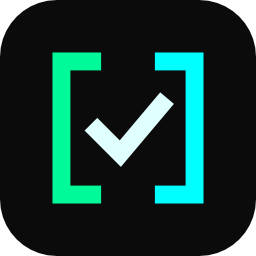

<p align="center">
  <a href="https://github.com/jeancodogno/specforce-kit/">
    <picture>
      <source media="(prefers-color-scheme: dark)" srcset="https://raw.githubusercontent.com/jeancodogno/specforce-kit/main/assets/brand/lockup-dark-256.png">
      <source media="(prefers-color-scheme: light)" srcset="https://raw.githubusercontent.com/jeancodogno/specforce-kit/main/assets/brand/lockup-light-256.png">
      
    </picture>
  </a>
</p>
<p align="center">Spec-Driven Development para agentes de IA.</p>

# Specforce

<p align="center">
  <a href="https://github.com/jeancodogno/specforce-kit/releases"></a>
  <a href="https://github.com/jeancodogno/specforce-kit/actions/workflows/ci.yml"></a>
  <a href="https://goreportcard.com/report/github.com/jeancodogno/specforce-kit"></a>
  <a href="https://www.npmjs.com/package/@jeancodogno/specforce-kit"></a>
  <a href="go.mod"></a>
  <a href="https://github.com/jeancodogno/specforce-kit/issues"></a>
  <a href="https://github.com/jeancodogno/specforce-kit/pulls"></a>
  <a href="LICENSE"></a>
</p>

<p align="center">
  <a href="README.md"></a>
  <a href="README.pt.md"></a>
  <a href="README.es.md"></a>
</p>

> **A Camada de Orquestração para Engenharia Nativa de IA.**

O Specforce Kit é um framework de nível profissional projetado para coordenar agentes de IA (Claude Code, Cursor, Codex, KiloCode e outros) através do **Desenvolvimento Orientado por Especificação (SDD - Spec-Driven Development)**. Ele fornece as **Skills**, a **Constituição** e as **Ferramentas de Orquestração** padronizadas necessárias para transformar a IA de um assistente "baseado em vibes" em uma força de engenharia determinística.

---

## 🧠 Filosofia

Na era da IA, a implementação é uma commodity, mas o design é uma responsabilidade. **A implementação sem uma especificação é estritamente proibida no Specforce.**

O Desenvolvimento Orientado por Especificação (SDD) desacopla o design da implementação. Uma especificação atua como um contrato rigoroso entre designers humanos e executores de máquina. Ao fazer isso, evitamos o "vibe coding" - o acúmulo de decisões ad-hoc e não verificadas - garantindo que seu sistema permaneça coerente, seguro e sustentável, independentemente de qual agente de IA escreva o código.

---

## 📊 Por que usar o Specforce?

A codificação por IA sem diretrizes rígidas leva inevitavelmente ao "vibe coding": prompts vagos, resultados imprevisíveis e uma montanha de dívida técnica que se acumula rapidamente. Embora outras ferramentas tentem resolver isso, elas muitas vezes forçam você a novos ecossistemas de IDE, exigem configurações pesadas ou incham a janela de contexto da sua IA.

O Specforce foi projetado para ser a **camada de orquestração invisível**. Ele traz previsibilidade, controle arquitetônico e verificação rigorosa aos seus fluxos de trabalho de IA, atuando como uma máquina de estados ativa em vez de apenas uma coleção de templates estáticos.

### Principais Diferenciais:

- **Constituição Segmentada**: Em vez de um único prompt massivo, as regras são divididas em domínios especializados (Arquitetura, UI/UX, Segurança). O agente carrega apenas o contexto exato de que precisa, mantendo os custos de tokens baixos e reduzindo alucinações.
- **Especificações com Tamanho e Deltas de Módulo**: Mudanças pequenas precisam apenas de uma lista de tarefas; as maiores acrescentam requisitos, design e um delta que mantém as especificações vivas dos módulos atualizadas.
- **QA Independente**: Após a implementação, um testador que não escreveu nenhum código verifica cada critério de aceitação; um veredito de falha bloqueia o arquivamento.
- **Hooks de Verificação Dinâmica**: Execute testes, linters ou scripts personalizados automaticamente antes que um agente seja autorizado a marcar uma tarefa como finalizada.
- **Suporte a Git Worktree**: Descubra e visualize nativamente especificações em múltiplas branches git simultaneamente, sem trocar de contexto.
- **Instruções Sensíveis ao Contexto**: Injete regras e restrições específicas dinamicamente com base no artefato ou fase em que o agente está trabalhando.
- **Agnóstico a Ferramentas**: A Constituição e as especificações ficam em `.specforce/`, não em arquivos específicos de ferramentas, então você pode trocar de ferramenta de IA sem perder o contexto do projeto.
- **Rápido e Sem Dependências**: Distribuído como um único binário, sem necessidade de configurações pesadas de Python ou ecossistemas forçados para iniciar seu projeto.

---

## 🤖 Uso pelo Agente (Skills)

O Specforce instala suas skills nativamente na sua ferramenta de IA. Peça uma skill pelo nome, em linguagem natural, no chat do seu agente; a sintaxe explícita de cada ferramenta está em [Invocando skills](docs/pt/supported-tools.md#invocando-skills). Este é o ciclo de vida padrão:

### 1. A Constituição (`spf.constitution`)
**Exemplo:** "Use spf.constitution para configurar a constituição: {descrição do projeto e stack}"

O primeiro passo em qualquer projeto. Isso gera a Constituição do seu projeto em `.specforce/docs/`: princípios, arquitetura, UI/UX, segurança, engenharia, governança e especificações dos módulos de domínio (`modules/`).
- **Segmentada:** O Specforce mantém seus próprios documentos especializados em vez de arquivos de regras específicos de ferramentas. O agente carrega apenas o que precisa, e o contexto permanece intacto quando você troca de ferramenta.
- **Configuração Interativa:** Descreva sua ideia de projeto e stack. O agente fará perguntas esclarecedoras para ajudá-lo a tomar decisões fundamentais.
- **Flexível:** Execute uma vez para configurar, ou execute novamente a qualquer momento para atualizar a constituição. Você pode usá-la em ideias novas ou apontá-la para um projeto existente para analisar e documentar sua arquitetura atual.

### 2. Descoberta (`spf.discovery`)
**Exemplo:** "Use spf.discovery para investigar: {ideia ou relato de bug}"

A fase de exploração. Use-a para fazer brainstorming de novas funcionalidades ou investigar problemas técnicos antes de se comprometer com um plano.
- **Somente Leitura para o Código do Produto:** O agente nunca edita seus arquivos existentes. As evidências descartáveis (testes, scripts, capturas de tela) ficam em `.specforce/scratch/`.
- **Consultiva:** O agente dá opiniões, trade-offs e escolhas recomendadas, e encontra a causa raiz de bugs.
- **Formalização:** Quando estiver pronto, peça para formalizar o resultado em uma proposta que o planejamento reaproveita.

### 3. Criando uma Especificação (`spf.spec`)
**Exemplo:** "Use spf.spec para planejar: {descrição do que adicionar ou modificar}"

Pronto para construir? O agente esclarece seus requisitos e escreve os artefatos exigidos pelo tamanho da especificação: `requirements.md`, `design.md`, `tasks.md` e os deltas de módulo. Você os revisa e aprova.

### 4. Implementação (`spf.implement`)
**Exemplo:** "Use spf.implement para implementar {especificação}"

Depois que você aprova a especificação, o agente segue rigorosamente as tarefas planejadas, executa seus hooks de verificação e termina com uma etapa de QA independente que registra um veredito para cada critério de aceitação.

### 5. Arquivamento (`spf.archive`)
**Exemplo:** "Use spf.archive para arquivar {especificação}"

Assim que a implementação estiver concluída e verificada, o agente aplica os deltas de módulo às especificações vivas (`.specforce/docs/modules/`), atualiza a Constituição se necessário e arquiva a especificação. O arquivamento é recusado enquanto houver tarefas pendentes, o delta não estiver aplicado ou o QA tiver falhado.

Para fluxos e dicas que cobrem bugs, redimensionamento, mudanças após a implementação, QA com falha e outros casos especiais, veja [Fluxos de Trabalho e Dicas](docs/pt/workflows.md).

---

## ⚡ Toque Humano

Enquanto o Specforce potencializa seus agentes de IA, os humanos interagem principalmente através de dois comandos de terminal:

### 1. Inicialização do Projeto
Configure a governança e as skills dos agentes para o seu projeto.
```bash
specforce init
```

### 2. O Console (TUI)
Inicie o centro de comando para monitorar a saúde do projeto, o progresso das especificações e as implementações dos agentes em tempo real.
```bash
specforce console
```

---

## 🛠️ Agentes de IA e Ferramentas Suportadas

O Specforce Kit foi projetado para ser agnóstico a ferramentas e instala suas skills nativamente para os assistentes de programação com IA mais populares:

- **Claude Code** (Anthropic)
- **Qwen** (Alibaba)
- **Kimi Code** (Moonshot AI)
- **OpenCode**
- **KiloCode**
- **Codex**
- **Antigravity**
- **Cursor**

*Não vê sua ferramenta favorita? Aceitamos PRs para adicionar novos kits!*

---

## 🚀 Primeiros Passos

### Instalação

**Usando NPM (Recomendado)**
```bash
npm i -g @jeancodogno/specforce-kit
```

**A partir do Código-Fonte (Requer Go 1.26+ e Make)**
```bash
git clone https://github.com/jeancodogno/specforce-kit.git
cd specforce-kit
make build
# Binary 'specforce' is created in the root.
# You can move it to your PATH manually or run it from here.
```

---

## 📚 Documentação

Para um mergulho mais profundo no Specforce Kit, confira nossa documentação oficial:

- [Primeiros Passos e Fluxo de Trabalho](docs/pt/getting-started.md): Configuração do ambiente, primeiros passos, atualizações e o ciclo de vida recomendado do Desenvolvimento Orientado por Especificação.
- [Fluxos de Trabalho e Dicas](docs/pt/workflows.md): Fluxos passo a passo, dicas e o que fazer quando uma etapa fica bloqueada.
- [Suporte a Git Worktree](docs/pt/git-worktrees.md): Guia para descoberta de especificações entre branches, console unificado e restrições de somente leitura.
- [Artefatos](docs/pt/artifacts.md): Os arquivos gerados (Constituição, Requisitos, Design, Tarefas), tamanhos de especificação, deltas de módulo e o relatório de QA.
- [Configuração](docs/pt/configuration.md): Guia para personalizar hooks e instruções.
- [Referência da CLI](docs/pt/cli.md): Todos os comandos e flags do terminal.
- [Ferramentas Suportadas](docs/pt/supported-tools.md): Agentes de IA suportados nativamente e como invocar as skills em cada um.

---

## 🔍 Resolução de Problemas

### "command not found: specforce"
Se você encontrar este erro após a instalação, geralmente significa que o diretório bin global do npm não está no `PATH` do seu sistema.

**Correção para macOS/Linux:**
Adicione a seguinte linha ao seu perfil de shell (ex: `~/.zshrc` ou `~/.bashrc`):
```bash
export PATH="$(npm config get prefix)/bin:$PATH"
```

**Correção para Windows:**
Certifique-se de que `%AppData%\npm` esteja em suas variáveis de ambiente.

Para uma resolução de problemas mais detalhada, veja [Primeiros Passos: Solução de problemas](docs/pt/getting-started.md#solução-de-problemas).

---

## 🤝 Contribuindo
Contribuições são bem-vindas! Veja nosso [CONTRIBUTING.pt.md](CONTRIBUTING.pt.md) para aprender como adicionar suporte para novos agentes de IA ou melhorar os kits existentes.

---

## 📜 Licença
Lançado sob a **Licença MIT**. Veja [LICENSE](LICENSE) para detalhes.
